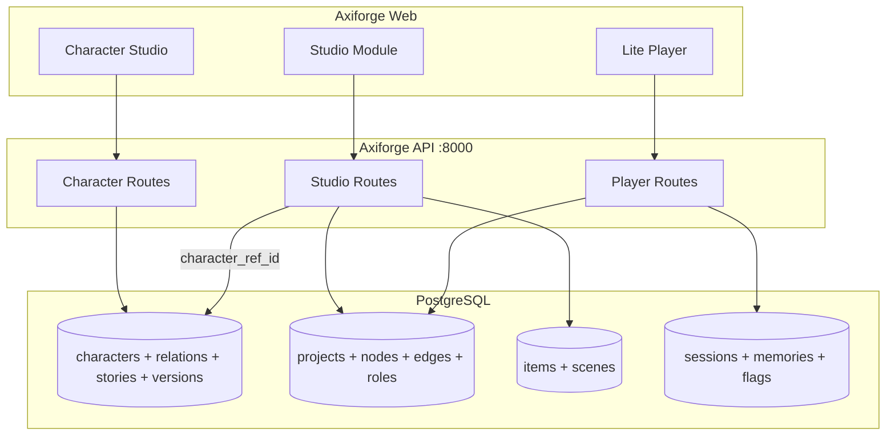

# Axiforge 重构方案 v1.0

> **文档性质**：可执行的工程重构蓝图，供后续分阶段实施。  
> **最后更新**：2026-07-06  
> **范围**：将 Grove + Axiforge-Workshop 融合为单一产品 **Axiforge**；根目录半成品 monorepo 作为承载体，可任意修改。

---

## 0. 一句话目标

**Axiforge = 角色优先的叙事 IP 资产管理与创作平台**——创作者在一个产品里完成「造角色 → 编剧本 → 跑体验」，角色可跨剧本复用、关系可追踪、记忆可积累；v1.0 交付可用的 Studio + Character Studio + Lite Player，**不**在现阶段落地 AI 自治世界或 Unity Full Player。

---

## 1. 你要做什么（意图复述）

### 1.1 产品本质

不是传统 VN 引擎，也不是纯写作工具，而是 **叙事操作系统** 的创作端：

| 维度 | 问题 | 系统模块 |
|------|------|----------|
| **Overall** | 氛围 / 主题 / 时间线 | Project 元数据 + Timeline（规划） |
| **Project** | 整体信息 | 剧本容器 |
| **Character (Who)** | 谁在行动 | 六层人格描述 + 运行时状态 + 关系网 |
| **Scene (Where)** | 在哪里 | 大场景嵌套小场景 |
| **Event (What)** | 发生什么 | 图节点 + 条件 + 效果 + 记忆 |
| **Item (How)** | 用什么 | 道具 + 机制标签（骰子/好感/时间/背包） |

核心理念（长期，v1.0 只搭骨架）：

- **关系持续性** — 角色记得玩家与彼此
- **记忆驱动** — 条件匹配依赖 SessionMemory / Flag，而非纯分支
- **世界可演化** — v1.5+ 才做自动推进；v1.0 仍是「创作者预设图 + 玩家手动触发」

### 1.2 融合决策（已确认）

| 旧名 | 处置 |
|------|------|
| Grove | **废弃**。Studio / Player / 剧本·道具·场景 → Axiforge 内部模块 |
| Axiforge-Workshop | **废弃**。角色工坊 → **Character Studio** |
| Relational Nova | **废弃**。对外统一品牌 **Axiforge** |
| 根目录 `frontend/` 原型 | **归档删除**（paper/ink/gold 设计 token 迁入 `packages/ui`） |
| `backend/main.py` 内存原型 | **删除或移入 `examples/`**，不与生产 API 共存 |

### 1.3 v1.0 边界（刻意不做）

- ❌ Event Sourcing 全量重写（Event Store + CQRS）
- ❌ Character Schema v2 一次性替换六层编辑器
- ❌ AI 意图生成 / 世界自主 `WORLD_TICK`
- ❌ Unity WebGL Full Player
- ❌ 社区大厅 / 模板市场
- ❌ 双端口 True/False 连线（保持 **单端口 + 边 label**）

---

## 2. 现状诊断

### 2.1 三份代码的真实状态

```
Axiforge/（根，重构中）
├── apps/web/          ← 主前端候选：Grove Studio/Player 已迁入，Workshop 整包复制但未接路由
├── backend/app/       ← 主后端候选：Grove + Workshop 路由/模型已复制，缺统一入口
├── backend/main.py    ← 独立内存原型，与 app/ 冲突
├── core/ + shared/    ← VN DSL 引擎雏形，与 DB Player 是两条线
├── frontend/          ← 旧壳，与 apps/web 重复
├── packages/ui/       ← 空壳
├── Grove/             ← 参考源，融合后删除
└── Axiforge-Workshop/ ← 参考源，融合后删除
```

### 2.2 关键断裂点

| # | 问题 | 影响 |
|---|------|------|
| 1 | `App.tsx` 未注册 `/studio/characters/*` | 角色 Tab 404 |
| 2 | 角色代码三处重复：`character/`、`components/characters/`、`hooks/` 双份 | 维护地狱 |
| 3 | 双角色数据模型：`characters` 表 vs `asset_characters` 表 | 引用混乱 |
| 4 | `backend/main.py` vs `backend/app/` | 端口/API 不一致 |
| 5 | Vite 代理：characters→8000，其余→8001 | 融合后应 **单后端单端口** |
| 6 | `pnpm-workspace` 不含 `frontend/` | workspace 与 lock 不同步 |
| 7 | Grove `CharacterPage` iframe 方案 | 与「内嵌子模块」初衷相反 |

### 2.3 应保留的资产（按价值排序）

1. **Workshop 角色全栈** — 六层编辑器、关系 D3 图、传记、版本、Fork、Prompt 导出（最成熟）
2. **Grove Studio** — React Flow 流程页、NodeEditor、条件/效果、项目/道具/场景 CRUD
3. **Grove Lite Player** — 打字机、分支、会话/记忆/标志运行时
4. **根目录 monorepo 骨架** — `apps/*` + `packages/*` + `core` + `shared`
5. **`core/shared` DSL** — 保留 package，v1.0 不接入 Player 主路径，为 v1.5 `.rn` / Unity 预留

---

## 3. 目标架构

### 3.1 Monorepo 结构（融合后）

```
axiforge/
├── apps/
│   └── web/                    # 唯一前端 @axiforge/web
│       └── src/
│           ├── app/            # 路由、layouts、providers
│           ├── modules/
│           │   ├── studio/     # 剧本·道具·场景·Graph
│           │   ├── character/  # Character Studio（Workshop 迁入）
│           │   └── player/     # Lite Player
│           ├── components/     # 跨模块共享组件
│           └── lib/            # api client、constants、utils
├── packages/
│   ├── ui/                     # 设计 token + 基础组件（Button、Input…）
│   └── types/                  # （可选）前后端共享 TS 类型
├── core/                       # @axiforge/core — 保留，v1.0 不阻塞
├── shared/                     # @axiforge/shared
├── backend/
│   ├── src/
│   │   ├── main.py             # 唯一入口
│   │   ├── config.py
│   │   ├── database.py
│   │   ├── models/
│   │   ├── schemas/
│   │   ├── routes/
│   │   │   ├── character/      # 原 Workshop
│   │   │   ├── studio/         # project / item / scene / asset
│   │   │   └── player/         # runtime session
│   │   └── services/
│   ├── pyproject.toml
│   └── uv.lock
├── docs/
│   ├── REFACTOR_PLAN.md        # 本文档
│   └── ADR/                    # 架构决策记录
├── pnpm-workspace.yaml
├── package.json                # 根 scripts: dev / build / lint
├── docker-compose.yml          # postgres + api + web（v1.0 末交付）
└── vercel.json                 # 对齐 Workshop 成熟部署模式
```

### 3.2 运行时拓扑（开发 & 生产）

**开发（融合后）：**

```
Browser :5174
    ↓ /api /uploads
FastAPI :8000  ──→  PostgreSQL (axiforge)
```

**禁止**：双后端、iframe 嵌 Workshop、characters API 与 studio API 分端口。

### 3.3 模块边界



---

## 4. 数据模型融合

### 4.1 核心原则

- **单一角色真相源**：只用 Workshop 的 `characters` 表体系，**删除** `asset_characters` 六层 JSONB 重复存储。
- **剧本引用角色**：`project_roles.character_ref_id` → `characters.id`（UUID）。
- **运行时状态分离**：`character_runtime_states` 存 emotion/flags/location（游玩时），不污染创作态 `character_data` JSONB。
- **插件已死**：删除 `AssetPlugin` / `plugin` routes；机制进 `items.mechanism_tags`。

### 4.2 表职责一览

| 表 | 职责 | 来源 |
|----|------|------|
| `characters` | 六层 `character_data`、头像、公开性、Fork | Workshop |
| `character_relations` | 关系边 | Workshop |
| `character_stories` | 传记 Markdown | Workshop |
| `character_versions` | 版本快照 | Workshop |
| `tags` / `character_tags` | 标签 | Workshop |
| `projects` | 剧本元数据 | Grove v0.3 |
| `project_nodes` / `project_edges` | 叙事图 | Grove |
| `project_roles` | 剧本内角色槽位 → `characters.id` | Grove（改外键） |
| `asset_items` / `asset_scenes` | 全局道具/场景资产 | Grove |
| `runtime_sessions` + 子表 | 游玩会话 | Grove Player |

### 4.3 六层模型 vs Character v2（长期）

| 层 | v1.0 策略 |
|----|-----------|
| 六层 JSONB（锚点/轮廓/举止/内心/轨迹/羁绊） | **保留**，作为 Character Studio 创作态 UI 与 Prompt 导出 |
| Identity / State / Memory / Intention 四子系统 | **v1.5 映射层**：从六层 + 运行时派生，不阻塞 v1.0 融合 |
| Canon / Derivative / Interpretation | **v2.0** 再加 `canon_tier` 字段 |

> 工程判断：Workshop 六层编辑器是已验证的「人格生产线」；Design Spec 的四子系统是运行时语义。v1.0 两者 **并存不同层**，不做 Big Bang 替换。

---

## 5. 后端重构

### 5.1 统一入口

新建 `backend/src/main.py`（或整理现有 `app/` 为 `src/`）：

```python
# 伪代码 — 结构示意
app = FastAPI(title="Axiforge API")
app.include_router(character_router, prefix="/api/v1")
app.include_router(studio_router, prefix="/api/v1")
app.include_router(player_router, prefix="/api/v1")
app.include_router(upload_router, prefix="/api/v1")
```

- 删除根目录 `backend/main.py` 内存原型。
- CORS、静态 `/uploads`、health 同 Workshop 成熟配置。
- 数据库名：`axiforge`（非 `grove`）。
- 迁移：v1.0 允许 `v03_rebuild.py` 式 **删表重建**（你自己文档里的原则）。

### 5.2 路由整合

| 前缀 | 模块 | 说明 |
|------|------|------|
| `/api/v1/characters/*` | Character | Workshop 原路由，基本不动 |
| `/api/v1/relations/*` | Character | 关系预设 + CRUD |
| `/api/v1/tags/*` | Character | 标签 |
| `/api/v1/upload` | Shared | 头像上传 |
| `/api/v1/editor/projects/*` | Studio | 剧本 CRUD + 图 |
| `/api/v1/editor/assets/items/*` | Studio | 道具 |
| `/api/v1/editor/assets/scenes/*` | Studio | 场景 |
| `/api/v1/search/*` | Studio | 全局搜索（含 characters） |
| `/api/v1/play/*` | Player | 会话 start/draw/complete |

### 5.3 待删除后端代码

- `models/asset.py` 中 `AssetCharacter`
- `routes/editor/asset.py` 中 character CRUD
- `services/plugin.py`、`models/script.py` 等 v0.2 遗留（若未注册则直接删）
- `services/script.py` 若与 `project.py` 重复

### 5.4 认证（v1.0）

保持 `author_id = "anonymous"` query 约定；API client 预留 token 头，**不**在 v1.0 实现 JWT。

---

## 6. 前端重构

### 6.1 唯一应用：`apps/web`

重命名 package：`@axiforge/web`（告别 `"name": "grove"`）。

**路由结构：**

```
/                           → redirect /studio
/studio                     → StudioLayout
  /projects                 → 剧本列表
  /projects/new
  /projects/:id
  /projects/:id/flow        → React Flow Graph
  /characters               → Character Studio 首页（大厅/我的）
  /characters/create
  /characters/:id
  /characters/:id/edit
  /characters/:id/stories/...
  /items ...
  /scenes ...
/play/:projectId            → Lite Player（独立 Layout，无 Studio Tab）
```

**删除重复：**

- 保留 `modules/character/`（Workshop 迁入，路径规范化）
- 删除 `src/character/` 与 `src/components/characters/` 的镜像重复
- 删除 `CharacterPage.tsx` iframe 方案

### 6.2 API 层

单一 `lib/api/client.ts`，base URL `/api/v1`，**不再**按路径分端口代理。

`vite.config.ts`：

```ts
proxy: {
  '/api': 'http://localhost:8000',
  '/uploads': 'http://localhost:8000',
}
```

### 6.3 状态与数据流

|  Concern | 方案 |
|----------|------|
| 服务端数据 | TanStack Query，`api/` + `hooks/` |
| 角色编辑 | Zustand `editorStore` + `draftManager` |
| UI  chrome | Zustand `uiStore` |
| 全局 userId | Zustand persist（同 Workshop） |

遵守 tech 宪章：**页面组件不直接 fetch**；三种数据形态（DB / API DTO / UI state）允许不同结构，在 `schemas` 或 `api/mappers` 转换。

---

## 7. UI 设计系统（重点）

### 7.1 设计定位

**工业叙事风（Industrial Narrative）** — 像精密仪器，不像二次元社区；信息密度高但层级清晰；动效克制；每个像素都有系统意义。

参考锚点（融合为一套 token，不保留两套主题）：

| Token | 值 | 用途 |
|-------|-----|------|
| `--color-brand` | `#3b3473` | 主色、Tab 指示、主按钮 |
| `--color-brand-muted` | `#3b3473 / 10%` | 选中背景 |
| `--color-surface` | `#ffffff` | 卡片、顶栏 |
| `--color-canvas` | `#f8f7f4` | 页面底色（纸感） |
| `--color-ink` | `#1f2937` | 主文字 |
| `--color-ink-muted` | `#9ca3af` | 次要文字 |
| `--color-accent` | `#c4944a` | 强调（来自旧 Axiforge gold，用于 Player HUD） |
| `--color-border` | `#f3f4f6` | 分割线 |
| `--radius-lg` | `1rem` | 卡片 `rounded-2xl` |
| `--font-sans` | `Inter, system-ui` | 全局 |

**Player 子主题**（仅 `/play/*`）：

- 全屏深色 `#0a0a0f`，对话框贴底，立绘区居中，HUD 半透明浮层
- 与传统 VN 一致，与 Studio 浅色工业风 **刻意对比**

### 7.2 布局范式

#### Studio Shell（剧本 / 道具 / 场景 / 角色列表）

沿用 Grove `StudioLayout` 骨架并升级：

```
┌─────────────────────────────────────────────────────────┐
│ [A] Axiforge · Studio          [GlobalSearch]  v0.3    │
├─────────────────────────────────────────────────────────┤
│  剧本 │ 角色 │ 道具 │ 场景          ← Tab，品牌色下划线   │
├─────────────────────────────────────────────────────────┤
│                                                         │
│   max-w-7xl mx-auto px-6 py-8                           │
│   ┌─────────┐ ┌─────────┐                               │
│   │  Card   │ │  Card   │  …                            │
│   └─────────┘ └─────────┘                               │
│                                                         │
├─────────────────────────────────────────────────────────┤
│            Axiforge · Narrative OS                      │
└─────────────────────────────────────────────────────────┘
```

- Tab 图标：v1.0 可保留 emoji 或换 Lucide 线性图标（推荐后者，更「工业」）
- 顶栏高度 56px，Tab 区与内容区背景色差一级

#### Character Studio（编辑/详情页 — 独立 Layout）

Workshop 手风琴编辑器 + 你的 Character Studio 蓝图：

```
┌─────────────────────────────────────────────────────────┐
│ ← 返回   角色名 · v3          [导出 Prompt] [版本] [保存] │
├──────────────────┬──────────────────────────────────────┤
│                  │                                      │
│  六层折叠面板     │   预览区                              │
│  (Anchor…)       │   · 头像 + 名称 + tags               │
│                  │   · 六边形 Radar（勇气/智慧/…）        │
│  ToggleInput     │   · 摘要 / 核心信念                   │
│  预设 + 自由输入  │                                      │
│                  │                                      │
├──────────────────┴──────────────────────────────────────┤
│  [关系图谱 D3]  │  [传记列表]  │  [Fork 链]              │
└─────────────────────────────────────────────────────────┘
```

- **关系图**：保留 Workshop 羊皮纸/赭石 D3 配色，作为 Character 模块 **唯一** 允许「叙事装饰风」的区域
- **六层语义色**（保留 Workshop 约定）：

| 层 | 色 |
|----|-----|
| 锚点 | blue |
| 轮廓 | purple |
| 举止 | green |
| 内心 | amber |
| 轨迹 | rose |
| 羁绊 | indigo |

#### Graph View（剧本流程）

- React Flow 画布：浅灰点阵背景 `#fafaf9`
- 节点：白底卡片 + 品牌色选中框；**单输出 handle**，边 label 为分支文案
- 侧栏 `NodeEditor`：条件/效果分组，记忆与标志用 Badge  Chips

#### Lite Player

- 无 Studio Tab；Esc 唤 HUD（记忆/标志/已触发事件）
- 打字机 30–50ms/字；分支按钮全宽 stacked
- 场景切换：跨 scene 才 fade，同 scene 硬切

### 7.3 `packages/ui` 交付清单

| 组件 | 说明 |
|------|------|
| `tokens.css` | 上述 CSS variables + `@theme` |
| `Button` | primary / ghost / danger；品牌色 |
| `Input` / `Textarea` | 统一 focus ring |
| `Badge` | 标签、机制 tag |
| `Card` | `rounded-2xl border border-gray-100 shadow-sm` |
| `EmptyState` | 插图 + CTA |
| `PageHeader` | title + description + actions slot |
| `TabBar` | Studio 顶栏 / 子导航复用 |
| `Skeleton` / `Spinner` | 加载态 |
| `Toast` | 全局操作反馈（从 Grove 迁入或 sonner） |

**规则：**

- `index.css` 只允许 `@import "tailwindcss"` + import tokens
- 业务组件禁止内联随机 hex；只用 token
- 新 UI **必须**走 `packages/ui`，禁止在 module 里再复制第三套 Button

### 7.4 UI 权限边界（对齐 Design Spec，v1.0  pragmatic）

| 允许 | 禁止 |
|------|------|
| 读 API 状态渲染 | 在组件内改 DB 字段后不经过 API |
| 用户操作 → API 调用 → 刷新 Query | 直接 mutate 全局「运行时 State」 |
| Player 内发 `draw/complete` 事件 | Player 内手写条件引擎 duplicate |

v1.0 Player 条件逻辑 **留在后端** `player.py`；`core/RuntimeEngine` 不对接主路径。

---

## 8. 分阶段实施计划

### Phase 0 — 地基（1–2 天）

**目标**：一个命令拉起全栈，零重复入口。

- [x] 根 `package.json` scripts：`pnpm dev` → 并行 web + api
- [x] 统一 `backend/src/main.py`；根目录 `main.py` 保留为兼容 shim
- [x] `pnpm-workspace` 对齐；删除 `frontend/`
- [x] `docker-compose` 仅 Postgres（`pnpm db:up`）
- [x] FastAPI `lifespan` 替换 `on_event`；测试环境 `TESTING=1` 跳过重复 `init_db`
- [x] API 集成测试（`pnpm test:api`：角色 / 剧本 / Player / 搜索）
- [x] GitHub Actions CI：`pnpm build` + Postgres + pytest
- [x] 更新 `vercel.json` 对齐单 API（`/api` + SPA fallback + `requirements.txt`）

**验收**：`pnpm dev` 后访问 `/studio/projects` 与 `/api/v1/health` 均 200。

### Phase 1 — 后端融合（2–3 天）

- [x] 合并 Workshop + Grove 路由到单 app
- [x] DB rebuild：`axiforge` 库，删除 `asset_characters`（`v04_drop_legacy`）
- [x] `project_roles.character_ref_id` → `characters.id`
- [x] 全局搜索含 characters
- [x] 上传路径 `/uploads` 统一

**验收**：Postman/curl 跑通 characters CRUD + project CRUD + play session。

### Phase 2 — 设计系统（2 天）

- [x] 实现 `packages/ui` tokens + 基础组件（26 个组件已迁入 `@axiforge/ui`）
- [x] StudioLayout 改用 `@axiforge/ui`（`TabBar` 组件，直接引用）
- [x] Player 深色子主题 CSS scope

**验收**：Storybook 或单页 showcase（可选）；Studio 视觉与旧 Grove 一致或更整洁。

### Phase 3 — Character Studio 接入（3–4 天）

- [x] 去重：只保留 `modules/character/`（页面 + 组件已统一）
- [x] 注册全部 `/studio/characters/*` 路由
- [x] `CharacterSearchSelect` 改打统一 API（剧本内选角）
- [x] 详情页：关系图 + 传记 + 版本 + Prompt 导出
- [x] Tab「角色」可点击可用

**验收**：不打开 iframe，完成「创建 → 编辑 → 关系 → 导出 Prompt → 在剧本中引用」闭环。

### Phase 4 — Studio 模块收尾（2–3 天）

- [x] Projects / Items / Scenes 页面接统一 API
- [x] Graph Flow：单端口、条件/效果面板、增量保存
- [x] 删除 plugin UI/API
- [x] GlobalSearch 跨模块

**验收**：创建剧本 → 画 3 节点图 → 绑定角色与场景 → 保存。

### Phase 5 — Lite Player（2 天）

- [x] Player 独立 layout + VN 交互 polish（layout 已接线，交互持续打磨）
- [x] 会话记忆/标志 HUD
- [x] 剧本内角色显示 Workshop 头像/名称

**验收**：从 Studio 点「运行」进入 Player，完成一条分支并写入 session memory。

### Phase 6 — 清理与归档（1 天）

- [x] 删除 `Grove/`、`Axiforge-Workshop/` 目录（或移入 `_archive/`）
- [x] 清理 path 注释 `# /Users/young/Code/Grove/...`（源码已清理）
- [x] README：Axiforge 单产品说明 + 快速开始
- [x] ADR-001：记录六层保留 vs v2 四子系统策略（`docs/ADR/001-six-layer-character-model.md`）

**验收**：repo 内 grep 无 `Grove`、`Workshop` 用户可见字符串（代码注释除外可逐步清）。

---

## 9. 关键决策记录（ADR 摘要）

| ID | 决策 | 理由 |
|----|------|------|
| ADR-001 | v1.0 保留六层 JSONB 创作模型 | Workshop 已完整可部署；替换风险 > 收益 |
| ADR-002 | 删除 `asset_characters`，单表 `characters` | 消除双真相源 |
| ADR-003 | Character 内嵌，不用 iframe | 统一导航、设计 token、SEO、部署 |
| ADR-004 | 单后端 :8000 | 消除 Vite 双端口代理 |
| ADR-005 | Player v1.0 走后端 runtime，不接 `core/` | 最快可玩；core 留 v1.5 |
| ADR-006 | UI 双主题：Studio 纸感 + Player 暗色 | 创作 vs 体验的场景分离 |
| ADR-007 | 删 plugin 实体，机制 tag 进 item | 你自己 v0.3 已定案 |

---

## 10. 风险与缓解

| 风险 | 缓解 |
|------|------|
| 六层 vs v2 四子系统长期分裂 | ADR + `presentation` / `identity` 字段渐进映射 |
| 大量重复文件合并冲突 | Phase 3 前 **先删后迁**，以 Workshop 文件为 win |
| DB rebuild 丢数据 | 开发库可接受；生产前再引入 Alembic |
| UI 融合后风格不一致 | Phase 2 强制 `@axiforge/ui`；Character 模块仅关系图保留特殊色 |
| Player 与 Graph 条件语义不一致 | 共用 `schemas/condition.py` 一套枚举 |

---

## 11. v1.0 验收标准（Definition of Done）

1. [x] **品牌**：用户可见处只有 **Axiforge**，无 Grove/Workshop。
2. [x] **单命令开发**：`pnpm dev` 启动 web + api（DB 需本机 Postgres 或 `pnpm db:up`）。
3. [x] **Character Studio**：六层编辑、关系图、传记、版本、Fork、Prompt 导出、图片上传 — 路由与 API 已接线。
4. [x] **Studio**：剧本/道具/场景 CRUD + React Flow 单端口图 + 条件/效果编辑。
5. [x] **引用**：剧本可搜索并绑定 Character Studio 中的角色。
6. [x] **Lite Player**：可玩通一条线，会话产生 memory/flag（`test_player_flow` 覆盖）。
7. [x] **UI**：Studio 工业纸感（`@axiforge/ui` + `TabBar`）；Player 传统 VN 全屏暗色。
8. [x] **代码**：无 triplicate 角色目录；无 iframe；无双后端；Alembic baseline 就绪。

---

## 12. v1.5+ 预留（只规划，v1.0 不实现）

| 版本 | 内容 |
|------|------|
| v1.5 | `core/RuntimeEngine` 与后端对齐；`.rn` DSL 导入导出；Character v2 映射层 |
| v2.0 | AI 节点；世界 tick；社区大厅 |
| v2.5 | Unity Full Player 通过 Event/State JSON 协议对接 |

---

## 13. 建议的首次 PR 序列

便于 review，每个 PR 单一维度（符合你的 tech 宪章）：

1. `chore: monorepo scripts + delete frontend prototype`
2. `feat(backend): unified FastAPI entry + merged routes`
3. `feat(db): axiforge schema rebuild, drop asset_characters`
4. `feat(ui): packages/ui tokens and primitives`
5. `feat(character): mount Character Studio routes, dedupe modules`
6. `feat(studio): wire projects/items/scenes to unified API`
7. `feat(player): polish Lite Player + session HUD`
8. `chore: remove archived Grove/Workshop folders + README`

---

## 附录 A：文件迁移映射

| 源 | 目标 |
|----|------|
| `Axiforge-Workshop/frontend/src/components/characters/**` | `apps/web/src/modules/character/components/**` |
| `Axiforge-Workshop/frontend/src/pages/**` | `apps/web/src/modules/character/pages/**` |
| `Axiforge-Workshop/backend/src/routes/**` | `backend/src/routes/character/**` |
| `Grove/frontend/src/apps/studio/**` | `apps/web/src/modules/studio/**` |
| `Grove/frontend/src/apps/player/**` | `apps/web/src/modules/player/**` |
| `Grove/backend/app/routes/editor/**` | `backend/src/routes/studio/**` |
| `frontend/src/App.css` tokens | `packages/ui/styles/tokens.css` |

---

## 附录 B：命名对照（代码内 grep 替换）

| 旧字符串 | 新字符串 |
|----------|----------|
| `Grove` | `Axiforge` |
| `grove-backend` | `axiforge-api` |
| `Axiforge Workshop` | `Character Studio` |
| `APP_NAME = "Grove"` | `APP_NAME = "Axiforge"` |
| `createdb grove` | `createdb axiforge` |

---

*本文档随实施进展更新。任何偏离须在 `docs/ADR/` 记录并回写本节。*
