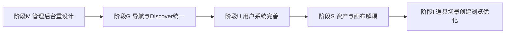

# Axiforge v3 重构计划（Admin 体验 / 导航统一 / 用户系统 / 资产画布解耦）

> **文档性质**：v3 阶段执行基准，接替 `REFACTOR_V2.md`（v2 的 R/N/A/E 四阶段已全部完成 ✅）。
> **最后更新**：2026-07-08
> **决策依据**：4 个并行子代理对 Admin 应用、Studio 资产与画布、用户身份系统、Discover/导航与浏览逻辑做了完整代码审计，结合用户提出的六大方向（Admin/Studio资产/用户系统/Discover/道具场景/导航）制定本计划。

---

## 0. 为什么要 v3

v2 补齐了结构、叙事核心、管理后台骨架与治理组件，但功能上线后暴露出新的债务：

| 症状 | 病灶 |
|------|------|
| Admin 7 个页面几乎不用 `@axiforge/ui`（仅用了 `Button`） | 组件库与实际界面脱节，无分页/统一加载态/Toast |
| "大厅""发现""我的"三套心智并存 | 浏览入口分散在 Discover 首页 12 条 + Studio 各资产的 Hall 标签 |
| `setDisplayName` 存在但无 UI 调用；无头像；身份操作分散在下拉菜单 | 用户系统"哑"了一半，功能不成体系 |
| 道具（`ProjectAssetRef`）从未被编译器/运行时消费 | 三层资产架构（全局库→项目引用→画布节点）道具链路断裂 |
| "场景"一词同时指全局模板与项目舞台 | 术语混淆，画布入口深埋在详情页三级导航之后 |

v3 = **八个阶段**：M → G → U → S → I → V → P → C（组件 design token 对齐）。

## 架构决策

1. **导航拆分**：Discover 成为唯一的"公开浏览"入口（剧本/角色/道具/场景的"大厅"浏览全部收敛到这里）；Studio 只保留"创建 + 我的"，移除 Studio 内的"大厅/探索"标签页，浏览统一跳转 Discover。
2. **视觉统一**：不做全局 dark/light 主题切换（成本高、非必须）。转而做：① Admin 应用从零散手写样式迁移到 `@axiforge/ui` 组件体系；② 补齐 `@axiforge/ui` 缺失的通用基元（`DataTable`/`Pagination`/`StatCard`/`ConfirmDialog`/`Toast`）。Discover 的暗色落地页视觉保留，顶部通用元素（账户菜单、Logo、字号）与 Studio 对齐。
3. **用户系统深度**：不引入密码/OAuth 真实认证，聚焦"让现有匿名身份系统好用"：补齐已断线的昵称编辑、加头像字段、整合成统一 `/profile` 页面、清理重复的邮箱绑定死代码。
4. **资产与画布解耦**：保留现有"全局库→项目引用→画布节点"三层架构，重点修复道具链路断裂、场景术语混淆、画布入口过深、详情页与画布页数据不同步等具体问题。

M 与 G/U 相对独立，可并行；S 依赖 G 的术语/入口决策，故排后。

---

## 阶段 M：管理后台重设计

现状（见 [apps/admin/src](../apps/admin/src)）：7 个页面几乎不用 `@axiforge/ui`（仅用了 `Button`），无分页、无统一加载/错误态、`confirm()` 做二次确认、Audit 的 `detail` JSON 不展示、Login 不校验 token。

- [x] 在 `packages/ui` 新增缺失基元：`DataTable`（列定义+排序+分页）、`Pagination`、`StatCard`/`MetricCard`、`ConfirmDialog`、`Toast`。
- [x] Admin 全部页面迁移到 `PageHeader`/`Card`/`Badge`/`EmptyState`/`ErrorDisplay`/`LoadingSpinner`/`Modal`/`SegmentedControl`。
- [x] 抽取 `useAdminList` hook 消除各页面重复的 fetch 样板。
- [x] `LoginPage`：登录时用 token 调一次真实接口校验，失败给出提示。
- [x] `ReportsPage`/`UsersPage`/`ContentPage`：`confirm()` 替换为 `ConfirmDialog`，并接入后端已支持但前端未暴露的 `note` 字段。
- [x] `AuditPage`：展开展示 `detail` JSON。
- [x] `AdminLayout` 侧边栏加图标分组（举报+违规归为"内容审核"，用户归为"人员"）。
- [x] 后端：`admin_service.list_violations` 的 `creator_id` 过滤改为 SQL 层过滤；补充分页 `offset` 参数（Users/Projects/Characters/Violations/AuditLogs 均改为 `PaginatedResponse`）。

## 阶段 G：导航与 Discover 统一

现状：`/discover` 只有 12 条作品+12 条角色的浏览区块；角色的完整大厅在 `features/character/pages/HallPage.tsx`，实际挂载在 `/studio/characters`；剧本/道具/场景在 Studio 内各自有"我的/大厅" `SegmentedControl`。

- [x] 将 Discover 扩展为多标签浏览页：剧本 / 角色 / 道具 / 场景（沿用 `HallPage` 已实现的搜索+标签+排序+分页逻辑）。
- [x] 迁移角色大厅：把 `HallPage.tsx` 的浏览能力并入 Discover，Studio 侧 `/studio/characters` 子导航移除"探索"标签，只留"创建"和"我的"。
- [x] `ProjectListPage`/`ItemsPage`/`SceneAssetsPage` 的 `SegmentedControl` 去掉"大厅"选项，改为"我的 / 模板"，页面顶部加"去 Discover 浏览更多"跳转入口。
- [x] 统一"我的"筛选交互模式（角色路由级分离 `mine` 子路由，其余 tab 状态，保持现状不强行统一）。
- [x] Discover 与 Studio 共享顶部账户菜单/Logo 视觉规范。

## 阶段 U：用户系统完善

现状（见 `UserContext.tsx` 与 `UserAccountMenu.tsx`）：`setDisplayName` 存在但无任何 UI 调用；无头像字段；`IdentityLinkPanel.tsx` 是无引用的死代码；`AuthorPage` 不读取 `display_name`。

- [x] 后端 `UserAccount` 模型加 `avatar_emoji`（emoji 头像简化方案，不接入图片上传）。
- [x] 新建统一 `/profile` 路由页面，整合：昵称编辑、头像选择、邮箱绑定/恢复（区分语义）、导出数据、注销账号（补充孤儿数据说明）。
- [x] 删除死代码 `IdentityLinkPanel.tsx`，收敛邮箱绑定到单一 `UserAccount.email` 路径。
- [x] `AuthorPage` 改为读取并展示 `display_name`/头像。
- [x] `UserAccountMenu` 精简为入口，点击跳转 `/profile`。

## 阶段 S：资产与画布解耦

现状（三层架构：`Character`/`AssetScene`/`AssetItem` 全局库 → `ProjectRole`/`ProjectScene`/`ProjectAssetRef` 项目引用 → `ProjectNode`/`ProjectEdge` 画布节点）：道具从未被编译器/运行时消费；"场景"一词双重含义；画布入口深埋；`ProjectFlowPage` 与 `ProjectDetailPage` 数据不同步。

- [x] 术语统一：全局库实体 UI 文案改为"场景模板"，项目级实体保持"舞台"。
- [x] 打通道具链路：扩展 Beat IR 和编译器，让 `ProjectAssetRef` 能被节点引用并编译进 runtime；`NodeInspectorPanel` 加"关联道具"选择器。
- [x] 画布入口前移：`ProjectDetailPage` 顶部/项目卡片加一级"打开画布"入口。
- [x] 数据同步：`ProjectFlowPage` 取数迁移到与 `ProjectDetailPage` 共享的 React Query key。
- [x] 实现 `AssetScene.node_templates` 的实际导入逻辑。

## 阶段 I：道具与场景创建/浏览优化

- [x] 参照角色创建表单的完整度，补齐道具/场景创建表单的字段深度。
- [x] 道具的分类 chips 扩展到"我的"视图和创建表单。
- [x] 道具/场景增加"被引用次数"等使用统计展示。
- [x] 浏览能力随阶段 G 迁移至 Discover 后，此阶段专注于"创建体验"打磨。

## 阶段 V：Web UI 视觉统一

Discover / Studio / Profile / Author 顶栏、品牌标识、容器宽度与暗色控件样式不一致。

- [x] 抽取共享 `AppBrand` / `AppHeader`（Logo、分区标签、账户菜单、发现/创作跳转）。
- [x] 新增 `PublicLayout`（Discover + Author 暗色、Profile 浅色），统一 `max-w-7xl` 与 `h-14` 顶栏。
- [x] `StudioLayout` 迁移至 `AppHeader`，与 Discover 顶栏结构对齐。
- [x] `@axiforge/ui` 补齐 `SegmentedControl` / `FilterToolbar` / `FilterChip` / `SearchInput` / `LoadingSpinner` 的 `dark` 变体。
- [x] Discover 各 Tab 移除 hack 样式，改用组件 `variant="dark"`。
- [x] `ProfilePage` 接入公共布局与 `Toast`，与其他 Studio 页一致。

## 阶段 P：Player 与角色 Studio 页面壳统一

Player 与角色创作路径仍使用散落色值、重复页面壳，且 `HallPage` 已成死代码。

- [x] 新增 `playerTheme` 色值常量，Player 加载/错误/存档页统一引用。
- [x] `PlayerHudBrand`：HUD 区品牌 + 剧本/舞台副标题，与全站 Logo 对齐。
- [x] `Shell` 支持 `narrow`（`max-w-4xl`），角色页与 Studio 列表页共用。
- [x] 角色路径：`CreateCharacterPage` / `EditCharacterPage` / `MyCharactersPage` / `CharacterDetailPage` 迁移至 `Shell` + `PageHeader` / `BackLink` / `Card` / `Toast`。
- [x] 删除已无路由的 `HallPage.tsx` 死代码。

## 阶段 C：组件 design token 对齐

角色 / Studio / 共享对话框仍散落 `gray-*`、`#3b3473` 硬编码，与 `@axiforge/ui` design token 不一致。

- [x] 角色模块：`gray-*` → `text-ink` / `bg-surface` / `border-border`；对话框迁移 `Modal` + `Input` + `ModalActions`（Fork / CreateStory / AddRelation / 版本历史）。
- [x] 角色页面壳：`StoryReadPage` / `StoryEditPage` 迁移 `Shell` + `BackLink`。
- [x] Studio：`ProjectCreatePage` 迁移 `PageHeader` + `Card` + `Input`/`Select`/`Textarea`/`Button`；`ProjectFlowPage` / `ProjectDetailPage` / Flow 组件 token 对齐。
- [x] 共享组件：`ItemCreateDialog` / `SceneCreateDialog` / `DraftRestoreDialog` 迁移 `Modal`；`ItemCard` token 对齐。
- [x] 零星收尾：`WriterPanel` / `RadarChart` / `ProfilePage` / `App` 路由 fallback；`ProjectFlowPage` / `StageLegend` 去除 `bg-white`；`apps/web` 内无残留 `gray-*` / `#3b3473` 硬编码。
- [x] 卡片体系：`cardTheme` + `Card`/`CardLink`/`EntityCard`/`CoverCard`/`EntityIcon` 支持 `theme="light|dark"`；`Badge`/`Button`/`EmptyState`/`ErrorDisplay` 支持暗色 `tone`；Discover 四 Tab + Author 页统一组件库卡片，消除原生 `<article>`/`<Link>` 内联样式。

---

## 交付物 / 验收

- 本文档固化八阶段计划，按阶段完成后回写勾选。
- 每阶段完成后跑 `pytest` + `tsc` + 前端 build 做验收（沿用 v2 的验收方式）。

| 阶段 | 核心验收 | 状态 |
|------|----------|------|
| M 管理后台 | Admin 全页面迁移到组件库，DataTable/分页/Toast 落地 | ✅ |
| G 导航统一 | Discover 多标签浏览可用，Studio 大厅标签移除 | ✅ |
| U 用户系统 | `/profile` 页面上线，昵称/头像可编辑 | ✅ |
| S 资产画布 | 道具链路打通，画布入口前移，数据同步 | ✅ |
| I 创建优化 | 道具/场景创建表单与统计展示完善 | ✅ |
| V UI 统一 | 顶栏/品牌/公共布局/暗色组件变体一致 | ✅ |
| P 页面壳 | Player HUD 品牌、角色 Studio 页 Shell 统一 | ✅ |
| C 组件对齐 | 角色/Studio/共享对话框 design token 与 Modal 统一 | ✅ |

详见 [LAYOUT_V2.md](./LAYOUT_V2.md)（阶段 D–F ✅）。

| 阶段 | 核心验收 | 状态 |
|------|----------|------|
| D Studio 壳 | 左侧栏导航 + CanvasWorkspace + WorkflowGuide | ✅ |
| E 品牌图标 | 无文字 AppIcon + favicon | ✅ |
| F Discover 氛围 | 背景纹理 + Hero + 统计条 + 空状态引导 | ✅ |

详见 [REFACTOR_V4.md](./REFACTOR_V4.md)（v4 已完成）。v2 执行基准见 [AXIFORGE_V2.md](./AXIFORGE_V2.md)。

| 阶段 | 核心验收 | 状态 |
|------|----------|------|
| L LLM 层 | Xinference/Ollama/Rules fallback + `/editor/ai` 迁移 | ✅ |
| A 创作者面板 | `/creator/dashboard` + Studio 概览页 | ✅ |
| C 评论 | 楼中楼 + 最新/最热 + Discover 详情讨论区 | ✅ |
| I 整合 | LLM 状态 UI + E2E + 文档勾选 | ✅ |

## v5 / Cut Studio（ADR-022）

剪辑工作台为剧本编辑默认入口：预览 + 时间轴壳 + 素材库；与 AXS 文本轨、Flow 结构图三轨投影。详见 [REFACTOR_CUT_STUDIO.md](./REFACTOR_CUT_STUDIO.md)。
