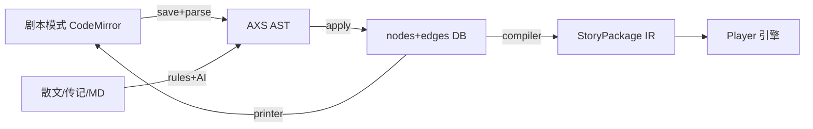

# Axiforge v2 重构总纲（demo → 可长期运营的系统）

> **文档性质**：v2 阶段唯一执行基准，接替 `ROADMAP_FINAL.md`（v1.1–v1.7 已完成部分保留为历史）。
> **最后更新**：2026-07-07
> **状态（2026-09-30）**：历史执行计划，v2/v3/v4 已完成且桌面产品边界已由 [ADR-029](../ADR/029-desktop-only-build-target.md) 重定。不要从本文恢复平台、社群或多应用待办；当前执行基准为 [`REFACTOR.md`](../REFACTOR.md)。
> **决策记录**：破坏性变更逐条落 ADR —— [ADR-016 AXS 叙事语言](../ADR/016-axs-narrative-language.md)、[ADR-017 节点独立与舞台化](../ADR/017-node-independence-and-stage.md)、[ADR-018 内容治理状态机](../ADR/018-content-governance.md)。

---

## 0. 为什么要 v2

v1.x 用七座桥证明了产品方向（演出即所得 / 角色记得你 / IP 流转），但系统仍是**单人 demo 体质**：

| 症状 | 病灶 |
|------|------|
| 改一个业务要横跨 models/schemas/services/routes 四个目录 | 横切分层，业务域被打散 |
| `backend/src/main.py` + `backend/app/` 双顶层包；`routes/editor/` 无意义嵌套 | 结构随手生长，无规划 |
| 前端 `src/apps/` 与 `src/modules/` 双轨并存 | 同上 |
| 拖拽节点创作占用创作时间的大头 | 创作核心交互与 VN 高频文本产出的形态错配 |
| 节点挂在场景下 | 概念错位：剧情逻辑不是场景附属 |
| 无审核/无处罚/无限流/无审计/CORS `*` | 上线即裸奔 |

v2 = **四个阶段**：R（结构）→ N（叙事核心）→ A（中台）→ E（治理）。

---

## Phase R：仓库结构重组（纯移动，不改行为）

### R1 后端：按业务域垂直切分

现状病灶：`backend/src/main.py` 与 `backend/app/` 双顶层包；`routes/editor/` 仅 3 个文件的嵌套；`app/migrations/` 死目录；`app/services/_-init__.py` 拼写错误文件；同一业务域散落 models/schemas/services/routes 四处。

目标结构（含旧文件 → 新位置的完整映射）：

```
backend/app/
├── main.py                  # ← src/main.py（删除 src/ 整个目录）
├── config.py / database.py  # 不动；database.register_models() 更新 import 路径
├── core/                    # 中间件、安全、限流、依赖注入（Phase E 填充）
├── domains/
│   ├── character/
│   │   ├── models.py        # ← models/{character,story,relation,version,tag}.py 合并
│   │   ├── schemas.py       # ← schemas 同名五件合并
│   │   ├── service.py       # ← services/character.py
│   │   ├── story_service.py / relation_service.py / version_service.py / tag_service.py
│   │   └── router.py        # ← routes 同名五件合并，底部导出 routers 列表
│   ├── narrative/
│   │   ├── models.py        # ← models/project.py
│   │   ├── schemas.py       # ← schemas/{project,ai}.py
│   │   ├── ir.py            # ← schemas/ir.py（IR 后端镜像）
│   │   ├── service.py / compiler.py / ai_draft.py / seed_showcase.py
│   │   └── router.py        # ← routes/editor/{project,ai}.py
│   ├── runtime/
│   │   ├── models.py        # ← models/{runtime,codex}.py
│   │   ├── schemas.py       # ← schemas/{runtime,save,codex}.py
│   │   ├── service.py       # ← services/player.py
│   │   ├── save_service.py / codex_service.py
│   │   └── router.py        # ← routes/player.py
│   ├── assets/              # ← asset 模型/schema/service + routes/editor/asset.py + upload.py
│   └── platform/
│       ├── models.py        # ← models/{user,identity,report}.py
│       ├── schemas.py / service.py / router.py
│       └── search_router.py # ← routes/search.py（跨域读归 platform）
└── tests/                   # 不移动；conftest 改 from app.main import app
```

原则：**一个业务域一个目录**，域内 models/schemas/service/router 平铺；域间通过显式 import 依赖（narrative → character，runtime → narrative）。

配套动作：全库更新 `uvicorn src.main:app` → `uvicorn app.main:app`（根 package.json、README、scripts、部署配置）；检查 `alembic/env.py` 的模型 import。

### R2 前端：统一 features 结构

现状病灶：`src/apps/`（studio/player/discover）与 `src/modules/`（character）双轨并存；顶层 api/components/hooks/lib/stores/types 六散。

```
apps/web/src/
├── main.tsx                 # 改 import './app/App'
├── app/
│   ├── App.tsx              # ← src/App.tsx
│   └── providers/           # ← src/contexts/（UserContext 等）
├── features/
│   ├── studio/  player/  discover/    # ← src/apps/*
│   ├── character/                      # ← src/modules/character
│   └── writer/                         # Phase N4 新增
└── shared/
    └── api/ components/ hooks/ lib/ stores/ types/   # ← src 顶层同名目录
```

Import 重写映射（`@/` 别名不动）：`@/apps/*`→`@/features/*`、`@/modules/character`→`@/features/character`、`@/{api,components,hooks,lib,stores,types}`→`@/shared/*`、`@/contexts/UserContext`→`@/app/providers/UserContext`。建议一次性 Node codemod 脚本完成，tsc 兜底修跨边界相对路径。

### R3 验收

- backend pytest 全绿（重组前基线 22 passed，行为零变化）
- core vitest 40 passed、web tsc + vite build 全绿
- 全库 grep 无旧路径 import 残留（`from app.models`、`from src.main`、`@/apps/`、`@/modules/` 等）

---

## Phase N：叙事核心重构

### N1 节点独立于场景（ADR-017）

**决策**：`project_nodes` 直挂 `project_id`；`scene_id` 改为可空 `stage_id`。场景（ProjectScene）语义降级为**舞台**——背景/氛围/位置的演出属性包，不再是节点的容器。

- 节点是剧情逻辑单元（Beat），几乎所有内容服务于角色与剧情
- Flow 画布升级为全剧本画布，舞台以泳道/着色呈现
- 编译器把 stage 信息折叠进 Beat 的演出指令（`@bg` 等）

**迁移步骤（Alembic 单迁移完成）**：

1. `project_nodes` 加可空列 `project_id`
2. 经 `project_scenes` 关联回填 `project_id`，然后设为非空 + 外键（CASCADE）
3. `scene_id` 重命名 `stage_id`，放开非空约束（表名 `project_scenes` 不改，避免无谓迁移）

**API 变化**：节点 CRUD 迁到项目级 `POST/PATCH/DELETE /editor/projects/{id}/nodes[/{nodeId}]`，请求体带可选 `stage_id`；场景嵌套节点路由废弃。受影响面：`ProjectService`、编译器（改为 project→nodes 直遍历）、`seed_showcase`、前端 Flow 页与 editor api client、相关测试。

### N2 关键帧-回合抽象

**统一定义：Beat = 关键帧 = 一个回合**（角色与环境/角色/道具交互的行为转换点）。

IR 扩展（`packages/core/src/ir.ts` 与后端镜像）：

```ts
interface Beat {
  // ...现有字段
  actors: string[];      // 本回合参与角色
  props: string[];       // 道具引用
  stage: string | null;  // 舞台 id
}
```

运行时语义不变；显式化「谁在场、用什么、在哪里」，为世界演化（tick）与 AI 运行时提供结构化落点。

### N3 AXS 叙事文本语言（ADR-016，核心投入）

**决策**：自研类 Markdown 剧本 DSL，**文本为真相源，节点图为投影**。新包 `packages/axs`。

```axs
# 雨夜 @stage(公寓) [key]
@bg apartment_rain
@bgm rain_piano loop

堰纱: ……你为什么会来这里？

> 我来帮你 -> 信任
> 只是路过 -> 疏远

## 信任 [ending: 信任结局]
@codex 堰纱.trust = high
堰纱(smile): ……谢谢。我会记住今晚。
```

**语法冻结面 v1**（完整定义见 ADR-016）：

| 类别 | 语法 |
|------|------|
| Beat 标题 | `# 标题 @stage(舞台) [key: 自定义键] [ending: 结局名] [if: 条件]` |
| 演出指令 | `@bg` `@bgm [loop]` `@se` `@voice` `@wait ms` `@transition kind ms` `@fx kind ms` `@camera zoom/pan/shake/reset ...` `@show 角色 [表情] [位置]` `@hide` `@move` |
| 效果指令 | `@flag k = v`、`@memory k = v`、`@state 角色.k = v`、`@codex 角色.k = v` → Beat effects |
| 对白 | `角色名: 台词`、`角色名(表情): 台词`（后者展开为 show+say） |
| 旁白 | 纯文本行；行首特殊字符用 `\` 转义 |
| 选项 | `> 文字 -> 目标标题`（无 `->` 落到下一 Beat） |
| 跳转 | 行 `-> 目标标题` 覆盖顺序自动连边 |
| 条件表达式 | `flag.k == v`、`codex.角色.k != v`、`&&` 组合（映射 IR 的 AtomCondition/all 组） |
| 注释 | `//` 行 |

**关键实现决策**：

- **Parser**：行式解析（无嵌套块），文本 → `{ beats, edges, diagnostics }`，带行号 ↔ beat 位置映射；未知 `@指令` 产生 warning 而非报错（axs_source 原样存储，投影不承担保内容责任）；重名 Beat 自动加 `-2/-3` 后缀键
- **Printer**：节点图 → 规范化文本；`parse(print(x)) ≡ x` 结构等价 + `print(parse(print(x))) = print(x)` 幂等
- **同步协议**：解析只有 TS 单实现（前端解析，避免双端 parser 漂移）；保存时把 `{ axs_source, nodes, edges }` 原子提交到 `PUT /projects/{id}/narrative`；冲突时文本优先
- **角色映射**：parse 接受 `roles: {名字 → characterRefId}` 回填 characterId；printer 反向还原显示名
- **测试**：parser/printer 100% 单测 + round-trip 性质测试（引擎级代码标准，同 `packages/core`）
- 散文/MD 导入：`ai_draft` 规则引擎输出接 AXS printer，形成「粘贴散文 → AXS 草稿 → 精修」流水线

### N4 沉浸式写作模式（features/writer）

- Studio 新增「剧本模式」Tab：CodeMirror 6（`@codemirror/state|view|language|autocomplete|lint`）
  - 语法高亮（StreamLanguage 级即可，不需要完整 Lezer 语法树）
  - 角色名/`@指令` 自动补全（角色源自项目 characterRefs）
  - parser diagnostics 直接映射为行内错误/警告标注
- 与 Flow 画布 Tab 级切换，光标行 ↔ 节点选中双向定位（靠 parser 的行号映射）
- 实时预览复用 core 引擎内嵌播放（前端本地 parse → 内存 StoryPackage，不经后端）
- 角色传记（`character_stories`）一键「转为 AXS 草稿」——传记成为角色个人剧情孵化器（规则引擎 → AST → printer）



---

## Phase A：管理中台（apps/admin）

独立 React 应用，复用 `packages/ui`，独立构建（端口 5174）。后端落 `domains/platform/`。

| 模块 | 内容 |
|------|------|
| 审核队列 | 举报处理（`content_reports`）、内容状态机操作（通过/下架/驳回） |
| 用户管理 | `user_accounts` 检索、封禁/解封、违规与 strike 查看 |
| 内容管理 | 作品/角色/资产全量检索、强制下架、发现页加精 |
| 数据 Dashboard | 创作漏斗（注册→建项目→发布→被玩）、消费面板（播放/浏览/Top 作品）、治理面板（待审数/时效/违规趋势/存储用量） |
| 审计日志 | `audit_logs` 查看器 |

**鉴权**：`ADMIN_TOKEN` 环境变量 Bearer 校验（当前无密码体系下的务实解）+ `user_accounts.role`（user/moderator/admin）为未来正式 RBAC 预留。

**明确不做**：实时大屏、行为级埋点分析（数据量不足，过度设计）。

---

## Phase E：企业级轻量治理组件（ADR-018，单体内实现）

| 组件 | 实现 |
|------|------|
| 内容校验管线 | 发布时敏感词/规则校验；`content_status`(draft/published/taken_down) 状态机加到 projects/characters；LLM 审核留接口 |
| 违规与处罚 | `violations` 表 + strike 计数；阈值自动禁发布；admin 可撤销 |
| 防盗刷 | 滑动窗口限流中间件（IP+token）；view/play 计数按 token 日去重 |
| 审计日志 | `audit_logs` 表，admin 与敏感操作全记录 |
| 存储优化 | 上传 sha256 去重、类型/尺寸白名单、图片压缩、孤儿资产清理脚本 |
| 网络安全 | CORS 白名单化、安全响应头、请求体大小限制 |
| 用户隐私 | 数据导出/注销 API（最简 GDPR）、日志脱敏 |
| 分发 | StoryPackage 编译缓存（ETag + 进程内 LRU，随 updated_at 失效） |
| 统计 | `events` 表（publish/play_start/play_end/fork）+ 日聚合，供 dashboard |

---

## 阶段顺序与验收

| 阶段 | 核心验收 | 状态 |
|------|----------|------|
| R 结构重组 | 全部测试零失败，无行为变化 | ✅ |
| N 叙事核心 | AXS round-trip 单测全绿；剧本模式可保存同步；节点独立迁移后可玩 | ✅ |
| A 中台 | 举报→处理→下架→审计 全链路可走通（`pnpm dev:admin` + `ADMIN_TOKEN`） | ✅ |
| E 治理 | 限流/审计/状态机/安全头已接入；CORS 白名单生效 | ✅ |

*每阶段完成后回写本文勾选；任何偏离先落 ADR。*
